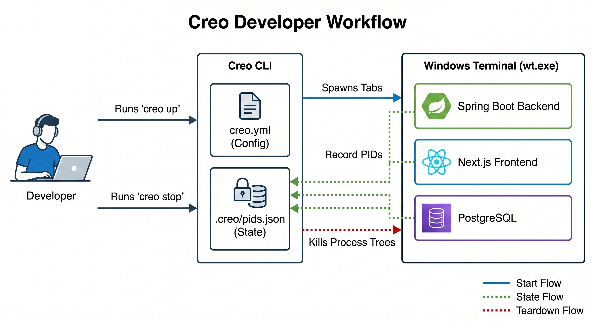

<p align="center">
  
</p>
<p align="center">
  <a href="https://github.com/tanmayythakare/creo/actions/workflows/ci.yml"></a>
  <a href="https://github.com/tanmayythakare/creo/releases/latest"></a>
  <a href="https://github.com/tanmayythakare/creo/blob/main/LICENSE"></a>
  
  
  <a href="https://d1dd4k2s3qs7qc.cloudfront.net"></a>
</p>

<p align="center">
  One command starts all your services in separate Windows Terminal tabs.<br>
  No scripts. No manual switching. Just run.
</p>

<p align="center">
  <a href="https://d1dd4k2s3qs7qc.cloudfront.net">
    <strong>Explore the Interactive 3D Showcase</strong>
  </a>
</p>

---

> [!IMPORTANT]
> **Requires Windows Terminal** (`wt.exe`). Install via `winget install Microsoft.WindowsTerminal` or the [Microsoft Store](https://aka.ms/terminal).

---

## How it works

<p align="center">
  
</p>

---

## Install

### For users — via Scoop (Recommended)

1. Make sure you have [Scoop](https://scoop.sh) installed. If not, open PowerShell and run:
   ```powershell
   Set-ExecutionPolicy -ExecutionPolicy RemoteSigned -Scope CurrentUser
   irm get.scoop.sh | iex
   ```
2. Add the custom creo bucket:
   ```powershell
   scoop bucket add creo-bucket https://github.com/tanmayythakare/scoop-bucket
   ```
3. Install `creo`:
   ```powershell
   scoop install creo
   ```
4. Verify the installation:
   ```powershell
   creo version
   ```

### Alternative — manual binary download

1. Download `creo.exe` from the [latest release](https://github.com/tanmayythakare/creo/releases/latest)
2. Place it in a folder (e.g. `C:\Tools\creo.exe`)
3. Add that folder to your PATH (System → Environment Variables → Path → Edit → New)
4. Open a new terminal and run:
   ```powershell
   creo version
   ```

### For contributors — build from source

```powershell
git clone https://github.com/tanmayythakare/creo
cd creo
go build -o creo.exe .
go test ./...
```

> Requires **Go 1.23+**

### For testers — verify on your stack

```powershell
git clone https://github.com/tanmayythakare/creo
cd creo
go build -o creo.exe .
# Place it in your PATH (or run ./creo.exe directly), then in any project:
creo init
creo <workflow-name>
```

---

## Quick Flow

```
creo init  →  detects your stack  →  generates creo.yml  →  creo <workflow>  →  all tabs open  →  start coding
```

---

## Usage

```powershell
# Analyze your repo and generate creo.yml
creo init

# Start a workflow (launches each service in its own wt.exe tab)
creo dev              # run the 'dev' workflow
creo boom             # run the 'boom' workflow

# Check what's running
creo status

# Stop everything
creo stop

# Stop one service
creo stop backend

# Restart a service
creo restart frontend

# Check all tools are installed
creo doctor

# Remove Creo from this project (stops services, deletes creo.yml and .creo/)
creo drop             # or: creo delete

# Show version
creo version
```

---

## creo.yml

Generated by `creo init`. Committed to your repo. Edit freely.

```yaml
project:
  name: my-app

services:
  frontend:
    path: frontend
    command: npm run dev
  backend:
    path: backend
    command: mvn spring-boot:run
  database:
    path: .
    command: docker compose up

workflows:
  boom:              # name this anything — boom, dev, start, go
    - frontend
    - backend
    - database
```

> [!TIP]
> Add `.creo/` to your `.gitignore`. It stores machine-specific runtime state (PIDs, lock files) that should never be committed:
> ```gitignore
> .creo/
> ```

---

## Detected stacks

`creo init` auto-detects 40+ frameworks across nested folder structures (scanning up to 3 directory levels deep, e.g. `apps/frontend/my-app/`), including:

React · Angular · Next.js · Vue · NestJS · Express · Django · FastAPI · Laravel · Flutter · Spring Boot (Maven + Gradle) · ASP.NET Core · Go · Docker Compose · Turborepo · and more.

---

## Commands

| Command | Description |
|---|---|
| `creo init` | Detect stack, generate `creo.yml` |
| `creo <workflow>` | Start all services in separate terminal tabs |
| `creo stop [service]` | Stop all services, or one by name |
| `creo status` | Show running/stopped state of all services |
| `creo restart [service]` | Stop and restart a service |
| `creo doctor` | Check all required tools are installed |
| `creo drop` (or `delete`) | Stop services and remove `creo.yml` and `.creo/` from project |
| `creo version` | Print version |

---

## Flags

| Flag | Description |
|---|---|
| `--dry-run` | Show what would happen without doing it |
| `--verbose` | Detailed output |
| `-f, --force` | Skip confirmation prompts (for `drop` and `init`) |

---

## Troubleshooting

**`wt.exe` not found**
Install Windows Terminal via `winget install Microsoft.WindowsTerminal`, then reopen your terminal.

**Another creo instance is already running**
A previous session left a stale lock. Delete `.creo/creo.lock` manually and retry.

**Windows Defender flags `creo.exe`**
creo launches processes and writes PID registries, which can trigger heuristic AV. Build it yourself with `go build -o creo.exe .` and add an exception in Defender.

**Service crashed — what does creo report?**
The terminal tab stays open with output visible. `creo status` correctly reports it as `stopped`.

---

## FAQ

**Can I name my workflow anything?**
Yes. `boom`, `dev`, `full-project` — any key under `workflows:` in `creo.yml` works. Run with `creo <name>`.

**Can I use special characters in service names?**
Service names are restricted to alphanumeric characters, underscores, hyphens, and periods (`^[a-zA-Z0-9_.-]+$`) to keep logs and registry records clean. For example, `Next.js` or `myorg.frontend` work perfectly as service names now.

**Does `creo doctor` run my custom script binaries?**
No. `creo doctor` uses a strict allowlist of known compiler and runtime binaries (such as `node`, `java`, `go`, `python`, `npm`, `cargo`, etc.) to verify tool availability, and safely skips checking custom or arbitrary script binaries.

**What does `.creo/` contain?**
Runtime state only — `pids.json` (active process registry) and `creo.lock` (instance lock). Never commit it.


## Contributing

See [CONTRIBUTING.md](CONTRIBUTING.md). PRs require CI to pass and maintainer approval before merging.

---

## License

MIT © 2026 Tanmay Thakare

---

<div align="center">
  <a href="https://github.com/tanmayythakare">
    
  </a>
</div>
